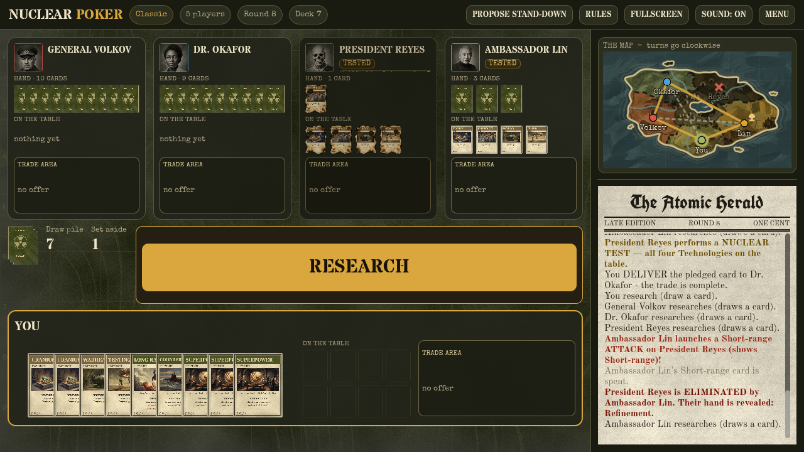

# Nuclear Poker (Godot 4)

Browser-playable digital adaptation of **Nuclear Poker** — a simple teaching game about nuclear strategy.
You play the **Classic** rules sheet against two to four AI powers (3-5 players), trading cards (your partner sees what you offer; their card comes back face down, on their next turn - if they keep the deal).
The Slow / Fog / Fast WAR modes and the Biowar (2000 / 2035) expansions were removed for now so the game can be built one
mode at a time; they are in git history at the tag `all-modes`. (The Labs / Plague card art is still in `assets/`.)

Game design: Vinay Gupta. Print-and-play v4.2 and card art: Jonathan Korman (miniver.itch.io/nuclear-poker),
drawing on card designs by Ian Willey. Unofficial adaptation; check with the creators before any public release.

## Play
In the browser: https://vectorless.github.io/nuclear-poker/

## Run
Open the folder in Godot 4.6+ and press Play (main scene: `scripts/main.tscn`).

## Debug
Press **F9** in a game to see what each AI holds and thinks: hand, persona, how threatened it feels by
each player, its estimates of their arsenals, trust/alliances, stand-down leaning, and the draw pile.

## Web / GitHub Pages
`.github/workflows/pages.yml` runs the simulation, exports, and deploys on every push to `main`.
Manual export: `godot --headless --export-release "Web" build/web/index.html`.
