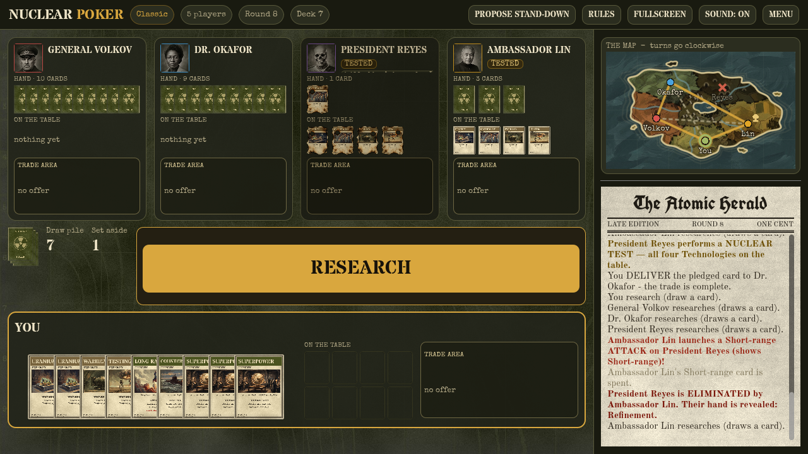

# Nuclear Poker (Godot 4)

Browser-playable digital adaptation of **Nuclear Poker**, a simple teaching game about nuclear strategy: collect the
four Technologies to test a weapon, the four Capabilities to become a Superpower, and decide whether to nuke, threaten,
trade with or disarm your neighbours. You play against two to four AI powers (3-5 players), each with traits of its own.
Trades can be broken, threats can force a trade or a disarmament, anyone can strike out of turn, and the game ends in
annihilation, a last power standing, a stand-down, hegemony, stalemate - or Mutually Assured Destruction, with a
special edition of the paper. The full rules are under **How to play** in the game.

Only the Classic game is implemented; the Slow / Fog / Fast WAR modes and the Biowar expansions are in git history at
the tag `all-modes`.

Original game by Vinay Gupta and Dan Carter (GNU FDL licensed), adapted from the original rules sheet for play against
AI powers. Unofficial adaptation. All art, portraits, photographs and audio are new, made for this version.

## Play
- In the browser: https://vectorless.github.io/nuclear-poker/
- On itch.io: https://vectorless.itch.io/nuclear-poker

## Run
Open the folder in Godot 4.6+ and press Play (main scene: `scripts/main.tscn`).

## Debug
Seven AI characters: the Hawk, the Deterrer, the Opportunist, the Wildcard, and three who think three levels deep -
the Pacifist, the Peacemaker and the Schemer (what they believe, what they think the others think of them, and how a
move will be read before they make it; `scripts/engine.gd`, "what the others think"). `tests/persona_test.gd` checks them.
Press **F9** in a game to see what each AI holds and thinks: hand, persona, how threatened it feels by
each player, its estimates of their arsenals, trust/alliances, stand-down leaning, and the draw pile.
**Debug transcript** (on the F9 panel, or the end screen) gives the whole game as text to copy out: every hand and
the trust between the powers at the start of each turn, the public log, and a `~` line for each AI decision with
the numbers it weighed.

Tests (`godot --headless --path . -s tests/<name>.gd`): `rules_test`, `trade_test`, `persona_test`, `human_sim`, and
`sim` (600 AI-vs-AI games, also run by CI).

## Licensing
- **Code** (scripts, scenes, tests, tools): [MIT](LICENSE).
- **Images, audio and music** (`assets/`): public domain, [CC0 1.0](LICENSE-ASSETS). Use them for anything.
- **Rules text** (How to play, the card descriptions, the summary above): adapted from Vinay Gupta and Dan Carter's
  original sheet, so [GNU Free Documentation License 1.3](LICENSE-RULES), no invariant sections or cover texts.
- **Fonts** (`fonts/`): SIL Open Font License 1.1, except Special Elite (Apache 2.0); licence files sit beside them.
- **Godot Engine** and its third-party components: MIT and others. The game's **Licences** screen (main menu) shows
  the full notices, as Godot's licence requires of a shipped build.

## Web / GitHub Pages
`.github/workflows/pages.yml` runs the tests and the simulation, exports, and deploys on every push to `main`.
Manual export: `godot --headless --export-release "Web" build/web/index.html`.
